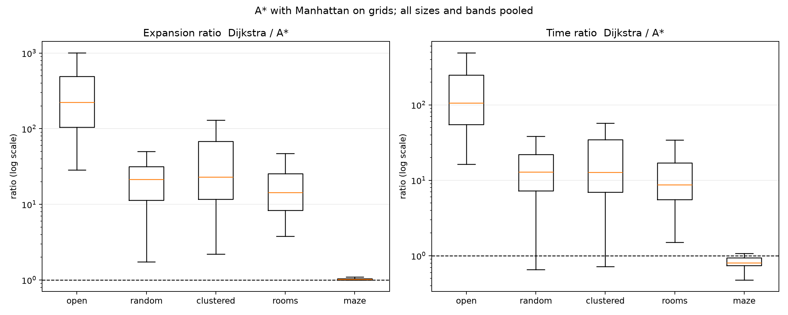
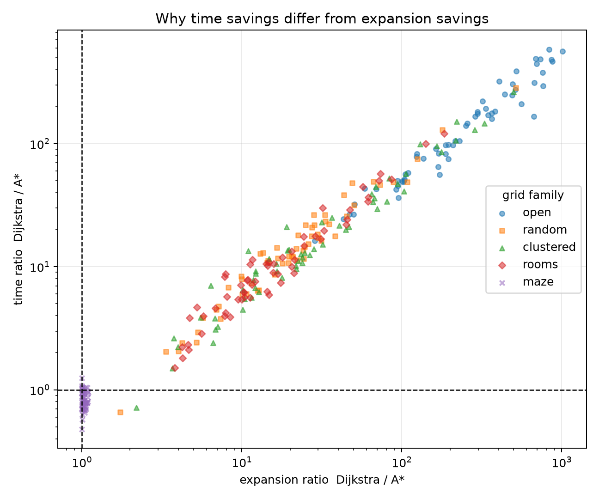
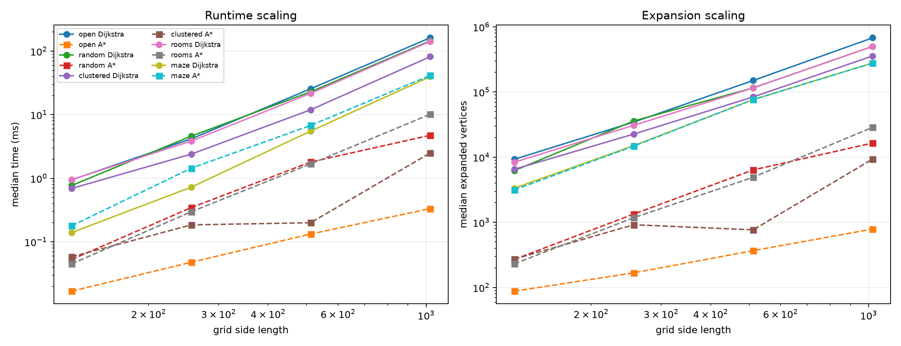
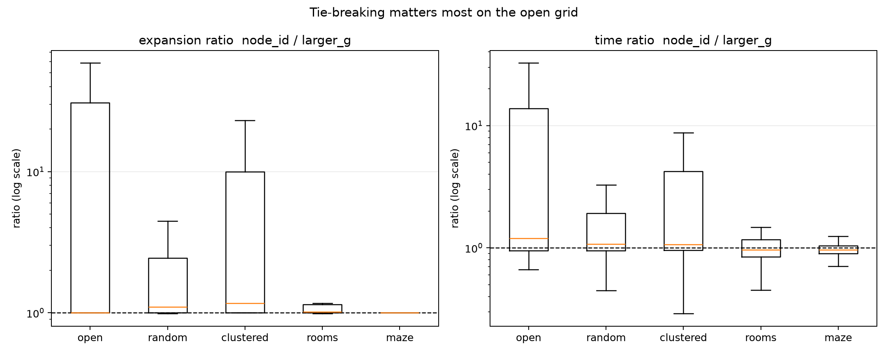
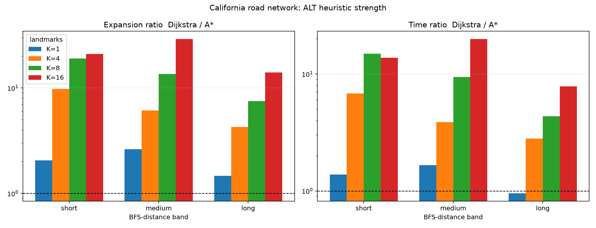

# Generated analysis
All tables use per-query medians over repeated runs and paired
Dijkstra/A* comparisons.  Ratio = Dijkstra / A*; values above 1 mean
A* wins.  Time is wall-clock time around the search call.

## Correctness

Rows: 3600; non-ok/incorrect rows: 0.

## Grid: main treatment (Manhattan, larger_g)

| family | n_pairs | time_ratio_median | time_ratio_q1 | time_ratio_q3 | exp_ratio_median | exp_ratio_q1 | exp_ratio_q3 | time_saving_pct_median | exp_saving_pct_median | a_faster_fraction | a_fewer_fraction | ns_per_exp_d_median | ns_per_exp_a_median | time_ratio_over_exp_ratio |
|---|---|---|---|---|---|---|---|---|---|---|---|---|---|---|
| clustered | 60.00 | 12.81 | 6.97 | 34.56 | 22.92 | 11.68 | 67.78 | 92.19 | 95.64 | 0.98 | 1.00 | 126.71 | 245.04 | 0.53 |
| maze | 60.00 | 0.81 | 0.75 | 0.94 | 1.02 | 1.00 | 1.05 | -23.95 | 1.90 | 0.17 | 1.00 | 64.86 | 78.82 | 0.79 |
| open | 60.00 | 105.66 | 54.86 | 249.26 | 222.45 | 105.11 | 490.29 | 99.05 | 99.55 | 1.00 | 1.00 | 142.23 | 288.30 | 0.53 |
| random | 60.00 | 12.84 | 7.23 | 21.89 | 21.41 | 11.28 | 31.72 | 92.21 | 95.33 | 0.98 | 1.00 | 156.53 | 254.14 | 0.62 |
| rooms | 60.00 | 8.73 | 5.58 | 16.98 | 14.31 | 8.35 | 25.55 | 88.54 | 93.01 | 1.00 | 1.00 | 146.00 | 270.42 | 0.61 |

## Grid by family and size

| family | size | n_pairs | time_ratio_median | exp_ratio_median | a_faster_fraction | time_ms_d_median | time_ms_a_median |
|---|---|---|---|---|---|---|---|
| clustered | 128 | 15.00 | 8.77 | 12.19 | 1.00 | 0.69 | 0.06 |
| clustered | 256 | 15.00 | 9.19 | 17.77 | 1.00 | 2.40 | 0.18 |
| clustered | 512 | 15.00 | 34.04 | 68.77 | 0.93 | 11.96 | 0.20 |
| clustered | 1024 | 15.00 | 25.15 | 40.64 | 1.00 | 81.81 | 2.50 |
| maze | 128 | 15.00 | 0.75 | 1.05 | 0.00 | 0.14 | 0.18 |
| maze | 256 | 15.00 | 0.77 | 1.02 | 0.00 | 0.72 | 1.44 |
| maze | 512 | 15.00 | 0.86 | 1.01 | 0.27 | 5.53 | 6.79 |
| maze | 1024 | 15.00 | 0.97 | 1.01 | 0.40 | 39.66 | 41.55 |
| open | 128 | 15.00 | 45.46 | 94.42 | 1.00 | 0.94 | 0.02 |
| open | 256 | 15.00 | 76.01 | 172.54 | 1.00 | 4.17 | 0.05 |
| open | 512 | 15.00 | 177.36 | 363.89 | 1.00 | 25.59 | 0.13 |
| open | 1024 | 15.00 | 389.85 | 696.31 | 1.00 | 162.16 | 0.33 |
| random | 128 | 15.00 | 12.02 | 19.72 | 0.93 | 0.77 | 0.05 |
| random | 256 | 15.00 | 11.28 | 21.88 | 1.00 | 4.61 | 0.35 |
| random | 512 | 15.00 | 12.74 | 14.57 | 1.00 | 22.96 | 1.80 |
| random | 1024 | 15.00 | 20.97 | 27.52 | 1.00 | 145.29 | 4.75 |
| rooms | 128 | 15.00 | 7.60 | 10.84 | 1.00 | 0.95 | 0.05 |
| rooms | 256 | 15.00 | 8.72 | 16.74 | 1.00 | 3.85 | 0.30 |
| rooms | 512 | 15.00 | 11.40 | 20.49 | 1.00 | 21.70 | 1.68 |
| rooms | 1024 | 15.00 | 8.74 | 10.88 | 1.00 | 142.30 | 10.16 |

## Grid by family and distance band

| family | band | n_pairs | time_ratio_median | exp_ratio_median | a_faster_fraction |
|---|---|---|---|---|---|
| clustered | long | 20.00 | 12.03 | 22.83 | 0.95 |
| clustered | medium | 20.00 | 14.28 | 24.28 | 1.00 |
| clustered | short | 20.00 | 11.91 | 20.86 | 1.00 |
| maze | long | 20.00 | 0.84 | 1.00 | 0.30 |
| maze | medium | 20.00 | 0.75 | 1.01 | 0.10 |
| maze | short | 20.00 | 0.82 | 1.05 | 0.10 |
| open | long | 20.00 | 155.98 | 294.87 | 1.00 |
| open | medium | 20.00 | 149.86 | 297.87 | 1.00 |
| open | short | 20.00 | 83.46 | 150.00 | 1.00 |
| random | long | 20.00 | 11.45 | 21.58 | 0.95 |
| random | medium | 20.00 | 12.84 | 20.12 | 1.00 |
| random | short | 20.00 | 14.41 | 22.17 | 1.00 |
| rooms | long | 20.00 | 9.49 | 20.81 | 1.00 |
| rooms | medium | 20.00 | 6.85 | 10.58 | 1.00 |
| rooms | short | 20.00 | 10.30 | 11.85 | 1.00 |

## Tie-break (node_id / larger_g)

| family | exp_ratio_nodeid_over_largerg_median | exp_ratio_nodeid_over_largerg_q1 | exp_ratio_nodeid_over_largerg_q3 | time_ratio_nodeid_over_largerg_median | time_ratio_nodeid_over_largerg_q1 | time_ratio_nodeid_over_largerg_q3 |
|---|---|---|---|---|---|---|
| clustered | 1.17 | 1.00 | 9.95 | 1.06 | 0.96 | 4.23 |
| maze | 1.00 | 1.00 | 1.00 | 0.96 | 0.90 | 1.04 |
| open | 1.00 | 1.00 | 30.83 | 1.20 | 0.95 | 13.85 |
| random | 1.10 | 1.00 | 2.45 | 1.07 | 0.95 | 1.92 |
| rooms | 1.02 | 1.00 | 1.14 | 0.97 | 0.85 | 1.17 |

## Real graph

| band | variant | n_pairs | time_ratio_median | time_ratio_q1 | time_ratio_q3 | exp_ratio_median | exp_ratio_q1 | exp_ratio_q3 | a_faster_fraction | time_ms_d_median | time_ms_a_median |
|---|---|---|---|---|---|---|---|---|---|---|---|
| long | astar_alt1 | 10.00 | 0.95 | 0.84 | 1.24 | 1.47 | 1.30 | 2.00 | 0.40 | 448.33 | 468.32 |
| long | astar_alt16 | 10.00 | 7.82 | 6.38 | 17.08 | 14.06 | 11.47 | 34.48 | 1.00 | 448.33 | 55.00 |
| long | astar_alt4 | 10.00 | 2.80 | 1.73 | 6.00 | 4.28 | 3.00 | 9.11 | 1.00 | 448.33 | 175.22 |
| long | astar_alt8 | 10.00 | 4.34 | 3.21 | 7.47 | 7.53 | 5.64 | 10.94 | 1.00 | 448.33 | 99.06 |
| medium | astar_alt1 | 10.00 | 1.66 | 0.94 | 2.27 | 2.62 | 1.46 | 3.56 | 0.70 | 257.56 | 147.23 |
| medium | astar_alt16 | 10.00 | 19.96 | 9.23 | 31.09 | 29.21 | 16.62 | 45.50 | 1.00 | 257.56 | 14.63 |
| medium | astar_alt4 | 10.00 | 3.87 | 2.75 | 7.47 | 6.13 | 4.32 | 10.89 | 1.00 | 257.56 | 68.02 |
| medium | astar_alt8 | 10.00 | 9.41 | 5.00 | 22.64 | 13.54 | 8.58 | 36.32 | 1.00 | 257.56 | 35.43 |
| short | astar_alt1 | 10.00 | 1.38 | 1.27 | 1.75 | 2.06 | 1.90 | 2.44 | 1.00 | 25.23 | 14.93 |
| short | astar_alt16 | 10.00 | 13.77 | 9.32 | 19.57 | 21.03 | 13.60 | 34.88 | 1.00 | 25.23 | 1.51 |
| short | astar_alt4 | 10.00 | 6.80 | 4.40 | 8.50 | 9.78 | 5.78 | 11.43 | 1.00 | 25.23 | 4.04 |
| short | astar_alt8 | 10.00 | 14.91 | 7.56 | 21.27 | 19.06 | 10.18 | 34.88 | 1.00 | 25.23 | 2.04 |

## Real graph by K

| variant | n_pairs | time_ratio_median | exp_ratio_median | time_saving_pct_median | exp_saving_pct_median | a_faster_fraction |
|---|---|---|---|---|---|---|
| astar_alt1 | 30.00 | 1.29 | 1.96 | 22.47 | 48.91 | 0.70 |
| astar_alt16 | 30.00 | 13.52 | 22.41 | 92.60 | 95.54 | 1.00 |
| astar_alt4 | 30.00 | 4.75 | 7.26 | 78.92 | 86.23 | 1.00 |
| astar_alt8 | 30.00 | 7.62 | 11.54 | 86.83 | 91.33 | 1.00 |

## Figures

