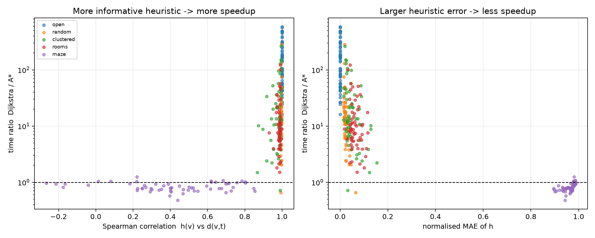
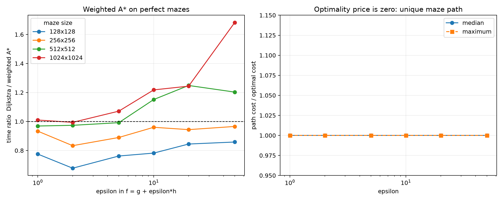

# Novelty analysis

## Heuristic informativeness

| family | n | h_corr | h_nmae | h_mae | detour | time_ratio | exp_ratio | ebf_a |
|---|---|---|---|---|---|---|---|---|
| clustered | 60 | 0.99 | 0.04 | 11.29 | 1.00 | 12.81 | 22.92 | 1.01 |
| maze | 60 | 0.42 | 0.97 | 8712.11 | 35.06 | 0.81 | 1.02 | 1.00 |
| open | 60 | 1.00 | 0.00 | 0.00 | 1.00 | 105.66 | 222.45 | 1.00 |
| random | 60 | 1.00 | 0.02 | 5.33 | 1.00 | 12.84 | 21.41 | 1.02 |
| rooms | 60 | 0.99 | 0.06 | 15.11 | 1.02 | 8.73 | 14.31 | 1.02 |

Spearman correlations with time ratio:

| feature | spearman_vs_time_ratio |
|---|---|
| h_corr | 0.78 |
| h_pearson | 0.78 |
| h_nmae | -0.81 |
| h_rmse | -0.70 |
| detour | -0.79 |
| ebf_a | -0.34 |

Simple explanatory models:

| model | r2 | intercept | slope |
|---|---|---|---|
| log(time_ratio) ~ h_corr | 0.412 | -1.605 | 4.601 |
| log(time_ratio) ~ h_nmae | 0.551 | 3.232 | -3.657 |
| log(time_ratio) ~ detour | 0.268 | 2.824 | -0.042 |

## Real road network

| n | h_corr | h_nmae | h_mae | time_ratio | exp_ratio |
|---|---|---|---|---|---|
| 30.000 | 0.982 | 0.155 | 53.705 | 7.620 | 11.541 |

| band | n | h_corr | h_nmae | h_mae | time_ratio | exp_ratio |
|---|---|---|---|---|---|---|
| long | 10 | 0.97 | 0.17 | 58.38 | 4.34 | 7.53 |
| medium | 10 | 0.98 | 0.17 | 51.92 | 9.41 | 13.54 |
| short | 10 | 0.99 | 0.14 | 39.81 | 14.91 | 19.06 |

Spearman correlations with time ratio:

| feature | spearman_vs_time_ratio |
|---|---|
| h_corr | 0.54 |
| h_nmae | -0.74 |
| h_mae | -0.77 |

## Weighted A* on perfect mazes

| epsilon | n | time_ratio | time_q1 | time_q3 | cost_ratio | cost_max | exp_ratio | expanded |
|---|---|---|---|---|---|---|---|---|
| 1.00 | 60.00 | 0.96 | 0.84 | 1.02 | 1.00 | 1.00 | 1.02 | 26929.50 |
| 2.00 | 60.00 | 0.90 | 0.75 | 0.99 | 1.00 | 1.00 | 1.04 | 26671.50 |
| 5.00 | 60.00 | 0.99 | 0.85 | 1.09 | 1.00 | 1.00 | 1.07 | 26213.50 |
| 10.00 | 60.00 | 1.10 | 0.86 | 1.29 | 1.00 | 1.00 | 1.10 | 25836.50 |
| 20.00 | 60.00 | 1.15 | 0.88 | 1.36 | 1.00 | 1.00 | 1.16 | 22576.00 |
| 50.00 | 60.00 | 1.18 | 0.93 | 1.48 | 1.00 | 1.00 | 1.27 | 23007.00 |

Time ratio by size:

| size | 1.0 | 2.0 | 5.0 | 10.0 | 20.0 | 50.0 |
|---|---|---|---|---|---|---|
| 128.00 | 0.78 | 0.68 | 0.76 | 0.78 | 0.84 | 0.86 |
| 256.00 | 0.93 | 0.83 | 0.89 | 0.96 | 0.94 | 0.97 |
| 512.00 | 0.97 | 0.97 | 0.99 | 1.15 | 1.25 | 1.20 |
| 1024.00 | 1.01 | 0.99 | 1.07 | 1.22 | 1.24 | 1.68 |

Paired Wilcoxon tests for the larger epsilon values:

| epsilon | size | n | time_ratio_median | wilcoxon_p |
|---|---|---|---|---|
| 10.00 | 128.00 | 15.00 | 0.78 | 0.08 |
| 10.00 | 256.00 | 15.00 | 0.96 | 0.76 |
| 10.00 | 512.00 | 15.00 | 1.15 | 0.03 |
| 10.00 | 1024.00 | 15.00 | 1.22 | 0.00 |
| 20.00 | 128.00 | 15.00 | 0.84 | 0.72 |
| 20.00 | 256.00 | 15.00 | 0.94 | 0.30 |
| 20.00 | 512.00 | 15.00 | 1.25 | 0.02 |
| 20.00 | 1024.00 | 15.00 | 1.24 | 0.00 |
| 50.00 | 128.00 | 15.00 | 0.86 | 0.76 |
| 50.00 | 256.00 | 15.00 | 0.97 | 0.56 |
| 50.00 | 512.00 | 15.00 | 1.20 | 0.01 |
| 50.00 | 1024.00 | 15.00 | 1.68 | 0.00 |

The path-cost ratio is 1.0 for every epsilon: a perfect maze has a
unique simple source-target path, so weighted A* cannot return a
different path.  Large epsilon changes the search order and can reduce
expansions, especially for short queries in large mazes.

## Tie-break tail

| family | n | median | q90 | q95 | max | fraction_gt_2 | fraction_gt_10 |
|---|---|---|---|---|---|---|---|
| clustered | 60 | 1.17 | 23.11 | 36.89 | 92.62 | 0.42 | 0.25 |
| maze | 60 | 1.00 | 1.00 | 1.00 | 1.01 | 0.00 | 0.00 |
| open | 60 | 1.00 | 97.77 | 166.66 | 285.70 | 0.45 | 0.37 |
| random | 60 | 1.10 | 8.07 | 13.55 | 51.54 | 0.27 | 0.07 |
| rooms | 60 | 1.02 | 2.15 | 6.17 | 17.76 | 0.10 | 0.03 |

