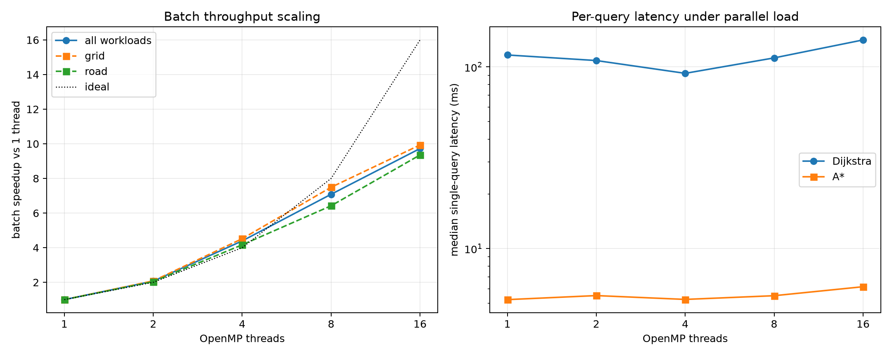
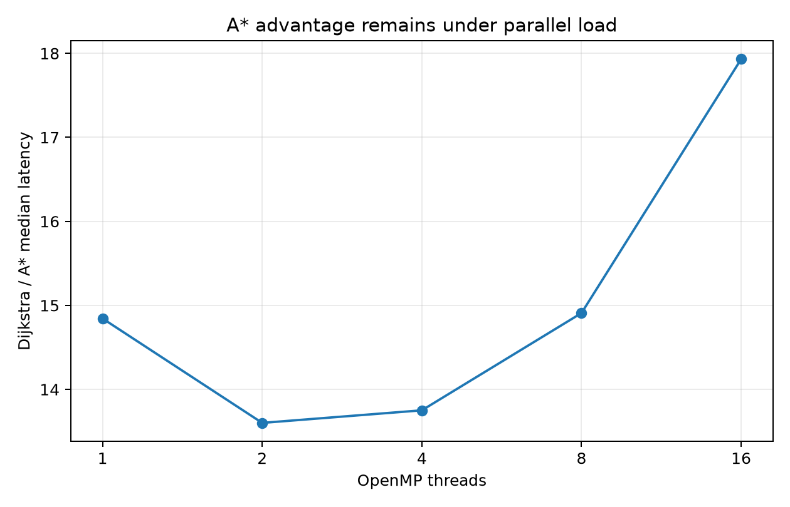

# OpenMP batch-throughput study

The frozen query-level results stay serial.  This study runs independent
queries concurrently, with one thread-local search scratch per worker and
both algorithms paired inside each task.  The workload is the five 1024x1024
grid families (15 queries each, 3 repeats) plus 30 road queries (3 repeats).

## Batch scaling

| threads | graphs | batch_seconds | speedup | efficiency |
|---|---|---|---|---|
| 1.00 | 6.00 | 44.39 | 1.00 | 1.00 |
| 2.00 | 6.00 | 21.48 | 2.07 | 1.03 |
| 4.00 | 6.00 | 10.11 | 4.39 | 1.10 |
| 8.00 | 6.00 | 6.27 | 7.08 | 0.89 |
| 16.00 | 6.00 | 4.56 | 9.73 | 0.61 |

| threads | workload | batch_seconds | speedup |
|---|---|---|---|
| 1 | grid | 29.14 | 1.00 |
| 1 | road | 15.25 | 1.00 |
| 2 | grid | 14.00 | 2.08 |
| 2 | road | 7.49 | 2.04 |
| 4 | grid | 6.45 | 4.52 |
| 4 | road | 3.66 | 4.17 |
| 8 | grid | 3.89 | 7.49 |
| 8 | road | 2.38 | 6.42 |
| 16 | grid | 2.93 | 9.93 |
| 16 | road | 1.63 | 9.36 |

## Per-query latency

| threads | queries | median_d_ms | median_a_ms | p95_d_ms | p95_a_ms | median_ratio_d_over_a | d_inflation_vs_1t | a_inflation_vs_1t |
|---|---|---|---|---|---|---|---|---|
| 1.00 | 270.00 | 116.32 | 5.24 | 481.11 | 91.53 | 14.84 | 1.00 | 1.00 |
| 2.00 | 270.00 | 108.40 | 5.51 | 444.32 | 90.25 | 13.60 | 0.93 | 1.05 |
| 4.00 | 270.00 | 92.17 | 5.25 | 435.42 | 81.69 | 13.75 | 0.79 | 1.00 |
| 8.00 | 270.00 | 112.09 | 5.50 | 469.34 | 92.44 | 14.91 | 0.96 | 1.05 |
| 16.00 | 270.00 | 140.75 | 6.17 | 568.17 | 126.50 | 17.93 | 1.21 | 1.18 |

## By family at 16 threads

| threads | family | median_d_ms | median_a_ms | median_ratio_d_over_a |
|---|---|---|---|---|
| 16 | clustered | 99.19 | 3.96 | 33.28 |
| 16 | maze | 49.61 | 58.62 | 0.87 |
| 16 | open | 203.54 | 0.37 | 431.82 |
| 16 | random | 179.52 | 5.53 | 23.89 |
| 16 | road | 444.39 | 21.94 | 9.19 |
| 16 | rooms | 180.82 | 11.68 | 8.25 |

The A* expansion advantage is unchanged; only wall-clock latency moves.
Efficiency is near one up to four threads and falls to 0.61 at 16
threads because the machine mixes performance and efficiency cores and
the road queries are memory-heavy.  Values slightly above one at two and
four threads are within frequency/run-to-run variation, not super-linear
scaling.
