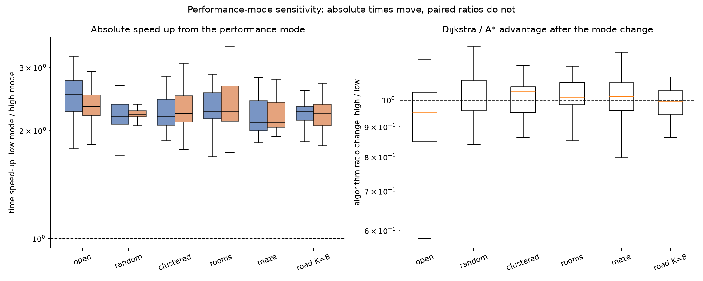

# Performance-mode sensitivity check

The frozen main run was collected with the host in its lowest performance/power mode.  This check reruns an exactly matched subset with the host in its higher performance mode.  The subset reuses the frozen graphs, query seeds, treatments and repeat counts, so every high-mode row is paired with a low-mode row on the same query.

The grid subset is sizes 128, 512 (all five families); the road subset is all 30 frozen queries.  Matched raw rows: 1,350 grid and 900 road.

## Verification

- All high-mode runs have `status=ok` and match the BFS distance oracle.
- Expansion counts and returned distances are **identical** in the two modes on every paired row; only wall-clock time changes.
- The comparison is paired within query, so query difficulty and source/target selection cannot explain a ratio change.

Absolute times are mode-specific and are not part of the frozen result.  The quantity that matters for the study is the paired Dijkstra/A* ratio.

The high-mode subset uses the current artifact build.  The frozen low-mode data predates the post-freeze weighted-A* branches in the shared search loop, so a small part of any timing movement could be code-version drift rather than the power mode.  Expansions and distances are unaffected, and the pooled ratio change is about 1%.

## Overall

| workload | queries | Dijkstra speed-up | A* speed-up | ratio change | Q1 | Q3 | CI low | CI high | p |
|---|---|---|---|---|---|---|---|---|---|
| grid Manhattan | 150 | 2.24 | 2.23 | 1.01 | 0.94 | 1.06 | 0.99 | 1.03 | 0.90 |
| road ALT K=8 | 30 | 2.26 | 2.23 | 0.99 | 0.94 | 1.04 | 0.97 | 1.02 | 0.21 |

A speed-up above 1 means the high-performance mode is faster.  A ratio change near 1 means the A* advantage is unchanged.

## Grids by family

| workload | family | queries | Dijkstra speed-up | A* speed-up | ratio change | Q1 | Q3 | CI low | CI high | p |
|---|---|---|---|---|---|---|---|---|---|---|
| grid | clustered | 30 | 2.19 | 2.23 | 1.03 | 0.95 | 1.05 | 0.99 | 1.05 | 0.63 |
| grid | maze | 30 | 2.11 | 2.11 | 1.01 | 0.96 | 1.07 | 0.99 | 1.07 | 0.42 |
| grid | open | 30 | 2.52 | 2.34 | 0.95 | 0.85 | 1.03 | 0.88 | 1.02 | 0.06 |
| grid | random | 30 | 2.19 | 2.22 | 1.01 | 0.96 | 1.08 | 0.97 | 1.05 | 0.70 |
| grid | rooms | 30 | 2.27 | 2.26 | 1.01 | 0.98 | 1.07 | 0.99 | 1.04 | 0.49 |

## Grids by size

| workload | size | queries | Dijkstra speed-up | A* speed-up | ratio change | Q1 | Q3 | CI low | CI high | p |
|---|---|---|---|---|---|---|---|---|---|---|
| grid | 128 | 75 | 2.21 | 2.21 | 1.02 | 0.96 | 1.06 | 1.00 | 1.04 | 0.40 |
| grid | 512 | 75 | 2.29 | 2.26 | 1.00 | 0.91 | 1.08 | 0.97 | 1.03 | 0.56 |

## Road network by landmark count

| workload | variant | queries | Dijkstra speed-up | A* speed-up | ratio change | Q1 | Q3 | CI low | CI high | p |
|---|---|---|---|---|---|---|---|---|---|---|
| road | astar_alt8 | 30 | 2.26 | 2.23 | 0.99 | 0.94 | 1.04 | 0.97 | 1.02 | 0.21 |

## Reading

The performance mode changes absolute wall-clock time substantially (about 2.2x for both algorithms), but the paired Dijkstra/A* ratios stay close to one: the same structural conclusion (informative heuristic -> A* wins; maze -> A* loses) holds in both modes.  The frozen `results/grid.csv` and `results/real.csv` remain the reported main data.

The one visible deviation is the open-grid family: its A* advantage falls by 4.6% in the high mode (ratio change 0.95, 95% CI 0.88--1.02, p=0.058).  This is not a structural reversal.  Open-grid A* takes only 17--133 microseconds per query, so its timings are the most sensitive to fixed overheads, cache state and scheduling, while Dijkstra's much larger search benefits more from the higher clock.  No other family or the road graph shows a significant change.
