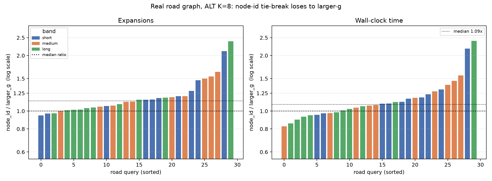

# Real-graph tie-break: node_id versus larger_g

This is exploratory post-freeze analysis of the frozen `results/real.csv`.  Both treatments use ALT with K=8 on the same 30 road queries and differ only in the tie-break: `astar_alt8` breaks equal f-values toward larger g, `astar_alt8_node_id` toward the smaller vertex id.  Each value is a per-query median over five repeats; ratios above 1 mean the node-id rule expanded more vertices or took longer.  The returned path cost is identical on every query.

## Summary

| scope | n | exp median | exp CI low | exp CI high | exp Q1 | exp Q3 | exp max | exp worse | exp wins | exp losses | exp ties | exp p | time median | time CI low | time CI high | time Q1 | time Q3 | time max | time worse | time wins | time losses | time ties | time p |
|---|---|---|---|---|---|---|---|---|---|---|---|---|---|---|---|---|---|---|---|---|---|---|---|
| overall | 30 | 1.138 | 1.060 | 1.185 | 1.041 | 1.204 | 2.391 | 0.900 | 3 | 27 | 0 | 4.42e-06 | 1.088 | 1.017 | 1.173 | 0.977 | 1.220 | 2.402 | 0.700 | 9 | 21 | 0 | 1.24e-01 |
| short | 10 | 1.166 | 1.061 | 1.337 | 1.086 | 1.265 | 2.116 | 0.800 | 2 | 8 | 0 | 6.45e-02 | 1.145 | 1.035 | 1.247 | 1.097 | 1.220 | 2.181 | 0.800 | 2 | 8 | 0 | 1.05e-01 |
| medium | 10 | 1.156 | 1.071 | 1.500 | 1.084 | 1.426 | 1.631 | 1.000 | 0 | 10 | 0 | 1.95e-03 | 1.129 | 1.023 | 1.386 | 1.050 | 1.359 | 1.559 | 0.800 | 2 | 8 | 0 | 1.05e-01 |
| long | 10 | 1.043 | 1.015 | 1.151 | 1.016 | 1.136 | 2.391 | 0.900 | 1 | 9 | 0 | 2.73e-02 | 0.996 | 0.924 | 1.072 | 0.936 | 1.053 | 2.402 | 0.500 | 5 | 5 | 0 | 8.46e-01 |

The error bars are 95% bootstrap intervals for the median ratio (10,000 resamples); the p-values are two-sided paired Wilcoxon tests on the raw counts/times.

## Paired detail

| pair | band | source | target | exp larger_g | exp node_id | exp ratio | time larger_g (ms) | time node_id (ms) | time ratio |
|---|---|---|---|---|---|---|---|---|---|
| 0 | short | 911366 | 557192 | 35564.000 | 42815.000 | 1.204 | 1.185 | 13.295 | 15.760 |
| 3 | short | 1630669 | 1463815 | 12759.000 | 12353.000 | 0.968 | 0.953 | 4.897 | 4.669 |
| 6 | short | 714133 | 222008 | 1623.000 | 1872.000 | 1.153 | 1.097 | 0.451 | 0.495 |
| 9 | short | 1766369 | 767422 | 10633.000 | 10065.000 | 0.947 | 0.972 | 3.092 | 3.005 |
| 12 | short | 1165597 | 61422 | 272.000 | 400.000 | 1.471 | 1.308 | 0.150 | 0.196 |
| 15 | short | 1341441 | 931370 | 25216.000 | 26825.000 | 1.064 | 1.232 | 6.938 | 8.548 |
| 18 | short | 356700 | 671359 | 586.000 | 1240.000 | 2.116 | 2.181 | 0.112 | 0.245 |
| 21 | short | 219453 | 222364 | 668.000 | 785.000 | 1.175 | 1.098 | 0.120 | 0.131 |
| 24 | short | 1331730 | 611354 | 35019.000 | 40496.000 | 1.156 | 1.124 | 11.536 | 12.962 |
| 27 | short | 1477924 | 109155 | 2802.000 | 3603.000 | 1.286 | 1.166 | 0.986 | 1.150 |
| 1 | medium | 911366 | 215906 | 1485.000 | 2227.000 | 1.500 | 1.456 | 1.079 | 1.572 |
| 4 | medium | 1630669 | 69005 | 24519.000 | 39993.000 | 1.631 | 1.559 | 9.457 | 14.739 |
| 7 | medium | 714133 | 671801 | 22138.000 | 23370.000 | 1.056 | 1.043 | 7.852 | 8.191 |
| 10 | medium | 1766369 | 502657 | 69946.000 | 78468.000 | 1.122 | 1.079 | 22.186 | 23.930 |
| 13 | medium | 1165597 | 1563177 | 119152.000 | 143491.000 | 1.204 | 0.975 | 48.682 | 47.459 |
| 16 | medium | 1341441 | 1544164 | 195754.000 | 209722.000 | 1.071 | 1.179 | 71.299 | 84.064 |
| 19 | medium | 356700 | 180085 | 131940.000 | 132293.000 | 1.003 | 0.826 | 49.068 | 40.548 |
| 22 | medium | 219453 | 889244 | 149941.000 | 178196.000 | 1.188 | 1.278 | 54.869 | 70.132 |
| 25 | medium | 1331730 | 1732324 | 141373.000 | 158964.000 | 1.124 | 1.071 | 57.064 | 61.104 |
| 28 | medium | 1477924 | 750153 | 34316.000 | 52854.000 | 1.540 | 1.386 | 13.229 | 18.338 |
| 2 | long | 911366 | 490026 | 64770.000 | 74550.000 | 1.151 | 1.062 | 28.896 | 30.684 |
| 5 | long | 1630669 | 1038951 | 351637.000 | 415700.000 | 1.182 | 1.118 | 157.352 | 175.906 |
| 8 | long | 714133 | 1420859 | 394417.000 | 409632.000 | 1.039 | 0.856 | 181.933 | 155.774 |
| 11 | long | 1766369 | 1237086 | 318496.000 | 761563.000 | 2.391 | 2.402 | 135.816 | 326.261 |
| 14 | long | 1165597 | 1227086 | 222811.000 | 233217.000 | 1.047 | 0.931 | 86.876 | 80.920 |
| 17 | long | 1341441 | 1033005 | 165809.000 | 168341.000 | 1.015 | 1.027 | 53.483 | 54.905 |
| 20 | long | 356700 | 1724705 | 112412.000 | 113512.000 | 1.010 | 0.899 | 36.647 | 32.950 |
| 23 | long | 219453 | 1711528 | 271319.000 | 296191.000 | 1.092 | 0.985 | 111.237 | 109.534 |
| 26 | long | 1331730 | 1022281 | 197143.000 | 200982.000 | 1.019 | 1.007 | 72.783 | 73.315 |
| 29 | long | 1477924 | 1112032 | 397131.000 | 385762.000 | 0.971 | 0.948 | 149.013 | 141.311 |

## Reading

**The node-id tie-break is worse, not neutral.**  Across the 30 queries it expands a median 1.14x as many vertices (+13.8%) and takes 1.09x the wall-clock time (+8.8%).  It is worse on 27/30 queries by expansions and on 21/30 by time.  The expansion difference is decisive (paired Wilcoxon p=4.42e-06); the time difference points the same way but is noisy (p=0.124), so expansions are the more reliable measure here.

**The tail is the risk, not the median.**  The largest expansion ratio is 2.39x and the largest time ratio is 2.40x.  A tie-break rule is a cheap change, but on a road graph with many equal f-values it can multiply the work on individual queries.

**Why larger_g helps here.**  When several frontier vertices share the same f-value, preferring the one with larger g means preferring the vertex closer to the target.  That tends to follow a single promising route instead of fanning out across plateau regions, which is exactly the tie pattern produced by a strong ALT bound.

This confirms the grid result on the real graph: the tie-break is not a cosmetic detail.  The main benchmark's `larger_g` choice is justified empirically, and a node-id rule should not be used as the default.

## Caveats

- The analysis reuses the frozen main run; no new timing data were collected, and `results/real.csv` is unchanged.
- Wall-clock noise is larger than expansion-count noise, so the time ratios are the less stable of the two measures.
- There are only 30 queries (10 per distance band); the bootstrap interval describes this query set, not all possible road queries.
