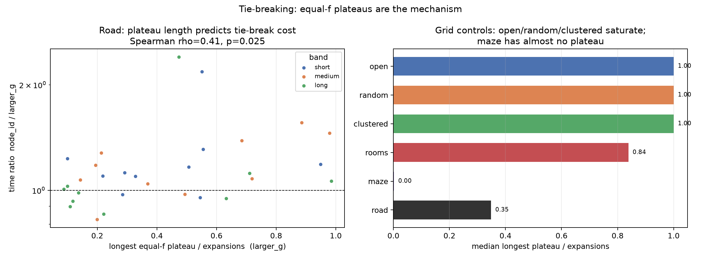

# Tie-break mechanism: equal-f plateaus

This is exploratory post-freeze analysis.  The new runs repeat the two tie-break treatments on the frozen query set and count maximal runs of settled vertices that share the same f value.  A long run is exactly where the tie-break rule can redirect the search.  Expansion and time ratios use the frozen per-query medians; the plateau counts come from the new deterministic runs.  Ratios above 1 mean node_id is worse.

## Summary

| family | n | max plateau | plateau share | exp ratio | time ratio | worst exp | worst time | rho exp | p exp | rho time | p time |
|---|---|---|---|---|---|---|---|---|---|---|---|
| open | 60 | 1.000 | 0.995 | 1.000 | 1.197 | 285.705 | 82.705 | - | - | - | - |
| random | 60 | 1.000 | 0.998 | 1.102 | 1.075 | 51.538 | 20.407 | 0.044 | 0.736 | 0.469 | 0.000 |
| clustered | 60 | 1.000 | 0.997 | 1.171 | 1.064 | 92.620 | 26.186 | 0.117 | 0.372 | 0.505 | 0.000 |
| rooms | 60 | 0.839 | 0.998 | 1.019 | 0.966 | 17.758 | 11.658 | -0.039 | 0.767 | 0.494 | 0.000 |
| maze | 60 | 0.002 | 0.869 | 1.000 | 0.963 | 1.015 | 1.329 | 0.316 | 0.014 | -0.209 | 0.108 |
| road | 30 | 0.349 | 0.999 | 1.138 | 1.088 | 2.391 | 2.402 | 0.525 | 0.003 | 0.409 | 0.025 |

The road graph is the informative case: the longest plateau covers a median 0.35 of the search, and longer plateaus go with larger node_id penalties (expansion rho=0.53, p=0.0029; time rho=0.41, p=0.025).

## Road graph: plateau tertiles

| bucket | n | max plateau | exp ratio | time ratio | worst exp | worst time |
|---|---|---|---|---|---|---|
| low | 10 | 0.128 | 1.055 | 1.017 | 1.188 | 1.278 |
| mid | 10 | 0.349 | 1.155 | 1.070 | 2.391 | 2.402 |
| high | 10 | 0.715 | 1.337 | 1.247 | 2.116 | 2.181 |

The low-plateau third is neutral (median time ratio 1.02), while the high-plateau third pays 1.25x median time and reaches 2.18x on its worst query.  The plateau length is a query-level explanation, not a claim that it can be known before running the search.

## Grid controls

The open grid is one long plateau (median max share 1.00): every settled vertex shares the same f value, so the tie-break decides the route and the tail can be hundreds of times worse.  Random and clustered grids are also saturated, while rooms has shorter plateaus.  The maze is the opposite extreme (median max share 0.002): its unique path leaves almost no equal-f choice, and node_id is neutral (time ratio 0.96).

This ties the earlier observations together.  Tie-breaking is not a median effect because plateaus are either absent or saturated in most grid families; the road graph has intermediate, query-dependent plateaus, which is where the choice of rule has a measurable cost.

## Caveats

- The plateau metric is collected after the search; it explains the penalty but is not a pre-query predictor.
- The new runs use one deterministic pass per treatment; all returned distances match the frozen oracles.
- Grid families are synthetic controls; only the road graph has intermediate plateau lengths.
