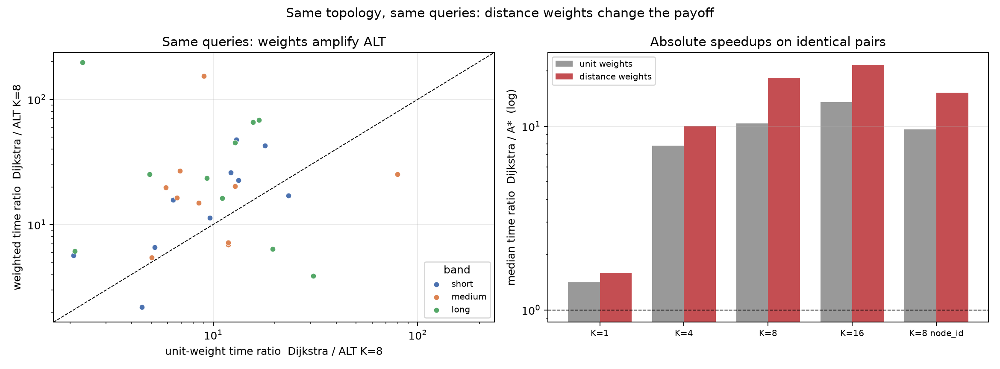

# Same-topology control: weighted versus unit edges

Both runs use the same 30 New York source-target pairs.  The weighted run uses DIMACS distance weights; the unit run replaces every edge weight with 1 and recomputes BFS ALT landmarks.  The graph topology and query set are therefore identical, isolating the effect of weights.  Ratios are paired per query and medianed over repeats.

## Correctness

- Every unit-run treatment returned the BFS hop distance; every weighted-run treatment returned the weighted Dijkstra distance.
- All rows are `status=ok` and `correct=1`.

## Speedups

| variant | n | weighted time | unit time | time gain | weighted exp | unit exp | exp gain |
|---|---|---|---|---|---|---|---|
| astar_alt1 | 30 | 1.589 | 1.415 | 1.123 | 2.254 | 2.164 | 1.042 |
| astar_alt4 | 30 | 10.016 | 7.844 | 1.277 | 14.575 | 13.150 | 1.108 |
| astar_alt8 | 30 | 18.367 | 10.358 | 1.773 | 25.762 | 17.702 | 1.455 |
| astar_alt16 | 30 | 21.620 | 13.556 | 1.595 | 31.095 | 23.902 | 1.301 |
| astar_alt8_node_id | 30 | 15.224 | 9.626 | 1.582 | 18.726 | 14.741 | 1.270 |

Time ratio is Dijkstra / A*.  The `gain` columns are weighted ratio divided by unit ratio; values above 1 mean the weight structure makes the treatment more valuable.

## Tie-break penalty

| metric | weighted | unit |
|---|---|---|
| node_id / larger_g time | 1.083 | 1.168 |
| node_id / larger_g expansions | 1.081 | 1.190 |

The `node_id` rule is worse than `larger_g` on both graphs, but the penalty is smaller under distance weights.  That is consistent with fewer exact equal-f plateaus when edges have non-uniform lengths.

## Reading

**Weights make ALT more valuable.**  ALT K=8 improves from 10.4x on unit weights to 18.4x on distance weights, a 1.77x increase in the speedup.  ALT K=16 moves from 13.6x to 21.6x.

**Weights reduce tie sensitivity.**  The median `node_id` / `larger_g` time penalty falls from 1.168x on unit weights to 1.083x on distance weights; the expansion penalty falls from 1.190x to 1.081x.

**The ranking is unchanged.**  ALT K=16 remains the fastest treatment in both regimes; weighting changes the size of the advantage, not the algorithm ordering.

## Caveats

- The unit run uses the weighted query pairs, so its bands are not BFS-distance bands; this is intentional for a paired control.
- The two runs use different oracles and ALT tables; only the topology and source-target pairs are shared.
