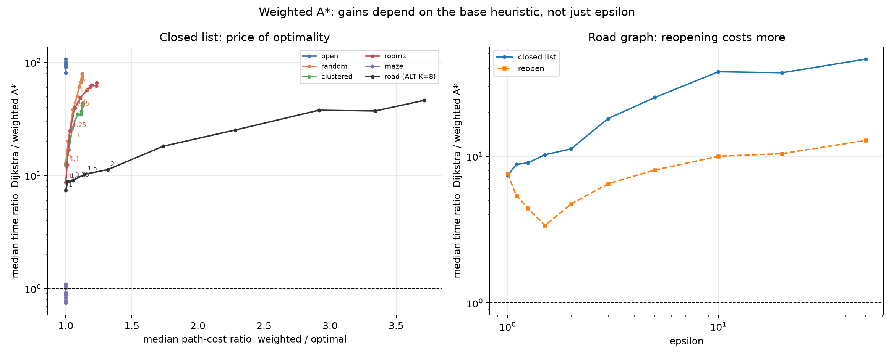

# Price of optimality on graphs with alternatives

Weighted A* uses `f = g + epsilon*h`.  The primary results use the practical closed-list policy (a settled vertex is not reopened); the reopening policy is kept as a sensitivity check.  The grid sweep covers 20 graphs (4 sizes x 5 families, 15 queries each, 3 repeats); the road sweep covers the 30 frozen queries with ALT K=8 and 5 repeats.  Ratios are paired per query, and the optimal cost is the BFS/Dijkstra distance.  This is exploratory post-freeze analysis.

## Correctness

- `epsilon=1` returned the optimal distance on every query, under both policies.
- No weighted run returned a distance below the optimum.
- Paired queries: 330 grid/road queries per epsilon; every row is a median over repeats.

## Closed-list sweep (primary)

| workload | epsilon | n | time ratio | Q1 | Q3 | exp ratio | cost ratio | cost p95 | cost max | optimal fraction |
|---|---|---|---|---|---|---|---|---|---|---|
| open | 1.00 | 60 | 106.89 | 54.99 | 212.98 | 222.45 | 1.00 | 1.00 | 1.00 | 1.00 |
| open | 1.10 | 60 | 80.70 | 38.32 | 227.18 | 222.45 | 1.00 | 1.00 | 1.00 | 1.00 |
| open | 1.25 | 60 | 91.10 | 41.43 | 275.85 | 222.45 | 1.00 | 1.00 | 1.00 | 1.00 |
| open | 1.50 | 60 | 92.57 | 43.57 | 282.68 | 222.45 | 1.00 | 1.00 | 1.00 | 1.00 |
| open | 2.00 | 60 | 96.06 | 45.68 | 283.33 | 222.45 | 1.00 | 1.00 | 1.00 | 1.00 |
| open | 3.00 | 60 | 97.87 | 45.97 | 277.16 | 222.45 | 1.00 | 1.00 | 1.00 | 1.00 |
| open | 5.00 | 60 | 99.77 | 48.17 | 281.30 | 222.45 | 1.00 | 1.00 | 1.00 | 1.00 |
| open | 10.00 | 60 | 99.50 | 49.47 | 293.85 | 222.45 | 1.00 | 1.00 | 1.00 | 1.00 |
| open | 20.00 | 60 | 99.74 | 49.54 | 288.47 | 222.45 | 1.00 | 1.00 | 1.00 | 1.00 |
| open | 50.00 | 60 | 94.10 | 47.43 | 275.74 | 222.45 | 1.00 | 1.00 | 1.00 | 1.00 |
| random | 1.00 | 60 | 12.83 | 6.83 | 21.41 | 21.41 | 1.00 | 1.00 | 1.00 | 1.00 |
| random | 1.10 | 60 | 20.11 | 13.38 | 37.38 | 37.13 | 1.02 | 1.06 | 1.07 | 0.30 |
| random | 1.25 | 60 | 38.24 | 25.20 | 95.06 | 69.57 | 1.05 | 1.13 | 1.15 | 0.13 |
| random | 1.50 | 60 | 50.41 | 34.39 | 127.62 | 95.67 | 1.08 | 1.17 | 1.22 | 0.07 |
| random | 2.00 | 60 | 60.70 | 44.63 | 146.08 | 107.34 | 1.10 | 1.21 | 1.23 | 0.07 |
| random | 3.00 | 60 | 66.86 | 46.85 | 165.61 | 114.42 | 1.12 | 1.26 | 1.31 | 0.03 |
| random | 5.00 | 60 | 70.63 | 51.56 | 174.28 | 116.28 | 1.12 | 1.27 | 1.35 | 0.03 |
| random | 10.00 | 60 | 73.93 | 54.51 | 183.83 | 116.74 | 1.12 | 1.27 | 1.35 | 0.03 |
| random | 20.00 | 60 | 78.33 | 56.32 | 190.08 | 117.02 | 1.12 | 1.27 | 1.35 | 0.03 |
| random | 50.00 | 60 | 79.36 | 56.86 | 193.54 | 117.02 | 1.12 | 1.27 | 1.35 | 0.03 |
| clustered | 1.00 | 60 | 12.58 | 6.27 | 35.01 | 22.92 | 1.00 | 1.00 | 1.00 | 1.00 |
| clustered | 1.10 | 60 | 12.06 | 6.87 | 31.24 | 24.20 | 1.00 | 1.03 | 1.04 | 0.50 |
| clustered | 1.25 | 60 | 16.84 | 8.43 | 40.98 | 29.27 | 1.02 | 1.10 | 1.17 | 0.30 |
| clustered | 1.50 | 60 | 26.45 | 9.28 | 46.03 | 40.73 | 1.05 | 1.15 | 1.21 | 0.23 |
| clustered | 2.00 | 60 | 34.86 | 13.01 | 55.59 | 49.41 | 1.09 | 1.20 | 1.39 | 0.15 |
| clustered | 3.00 | 60 | 34.66 | 15.78 | 68.29 | 64.36 | 1.12 | 1.25 | 1.43 | 0.15 |
| clustered | 5.00 | 60 | 36.86 | 17.83 | 87.45 | 78.45 | 1.12 | 1.29 | 1.43 | 0.15 |
| clustered | 10.00 | 60 | 41.29 | 21.25 | 96.36 | 84.79 | 1.13 | 1.31 | 1.49 | 0.15 |
| clustered | 20.00 | 60 | 43.82 | 22.67 | 101.04 | 86.68 | 1.13 | 1.31 | 1.49 | 0.15 |
| clustered | 50.00 | 60 | 42.41 | 23.44 | 103.97 | 86.68 | 1.13 | 1.31 | 1.49 | 0.15 |
| rooms | 1.00 | 60 | 8.71 | 5.35 | 15.44 | 14.31 | 1.00 | 1.00 | 1.00 | 1.00 |
| rooms | 1.10 | 60 | 12.46 | 6.13 | 27.48 | 24.84 | 1.01 | 1.04 | 1.07 | 0.40 |
| rooms | 1.25 | 60 | 24.84 | 10.54 | 46.00 | 45.55 | 1.03 | 1.09 | 1.11 | 0.27 |
| rooms | 1.50 | 60 | 39.64 | 15.84 | 79.92 | 68.87 | 1.07 | 1.17 | 1.21 | 0.12 |
| rooms | 2.00 | 60 | 48.49 | 20.92 | 102.60 | 77.29 | 1.11 | 1.21 | 1.32 | 0.08 |
| rooms | 3.00 | 60 | 56.69 | 22.56 | 109.86 | 80.87 | 1.16 | 1.33 | 1.63 | 0.08 |
| rooms | 5.00 | 60 | 60.68 | 25.02 | 115.94 | 85.12 | 1.19 | 1.45 | 1.63 | 0.07 |
| rooms | 10.00 | 60 | 62.92 | 29.17 | 127.66 | 87.05 | 1.19 | 1.46 | 1.74 | 0.07 |
| rooms | 20.00 | 60 | 62.21 | 33.18 | 134.03 | 88.52 | 1.23 | 1.52 | 2.05 | 0.07 |
| rooms | 50.00 | 60 | 66.27 | 34.88 | 138.35 | 88.69 | 1.23 | 1.52 | 2.05 | 0.05 |
| maze | 1.00 | 60 | 0.87 | 0.79 | 0.99 | 1.02 | 1.00 | 1.00 | 1.00 | 1.00 |
| maze | 1.10 | 60 | 0.75 | 0.68 | 0.87 | 1.02 | 1.00 | 1.00 | 1.00 | 1.00 |
| maze | 1.25 | 60 | 0.78 | 0.68 | 0.87 | 1.02 | 1.00 | 1.00 | 1.00 | 1.00 |
| maze | 1.50 | 60 | 0.82 | 0.70 | 0.90 | 1.03 | 1.00 | 1.00 | 1.00 | 1.00 |
| maze | 2.00 | 60 | 0.88 | 0.74 | 0.94 | 1.04 | 1.00 | 1.00 | 1.00 | 1.00 |
| maze | 3.00 | 60 | 0.88 | 0.72 | 0.96 | 1.04 | 1.00 | 1.00 | 1.00 | 1.00 |
| maze | 5.00 | 60 | 0.92 | 0.74 | 1.01 | 1.07 | 1.00 | 1.00 | 1.00 | 1.00 |
| maze | 10.00 | 60 | 1.01 | 0.75 | 1.13 | 1.10 | 1.00 | 1.00 | 1.00 | 1.00 |
| maze | 20.00 | 60 | 1.06 | 0.85 | 1.26 | 1.16 | 1.00 | 1.00 | 1.00 | 1.00 |
| maze | 50.00 | 60 | 1.10 | 0.86 | 1.44 | 1.27 | 1.00 | 1.00 | 1.00 | 1.00 |
| road | 1.00 | 30 | 7.40 | 4.49 | 15.61 | 11.54 | 1.00 | 1.00 | 1.00 | 1.00 |
| road | 1.10 | 30 | 8.82 | 4.50 | 14.25 | 13.83 | 1.01 | 1.04 | 1.04 | 0.10 |
| road | 1.25 | 30 | 9.03 | 4.44 | 14.58 | 15.03 | 1.05 | 1.11 | 1.21 | 0.03 |
| road | 1.50 | 30 | 10.25 | 4.40 | 17.46 | 16.45 | 1.14 | 1.29 | 1.35 | 0.00 |
| road | 2.00 | 30 | 11.26 | 5.66 | 29.58 | 18.33 | 1.32 | 1.58 | 1.58 | 0.00 |
| road | 3.00 | 30 | 18.15 | 6.79 | 48.73 | 29.70 | 1.74 | 2.20 | 2.40 | 0.00 |
| road | 5.00 | 30 | 25.25 | 8.37 | 59.03 | 37.01 | 2.28 | 3.00 | 3.67 | 0.00 |
| road | 10.00 | 30 | 37.79 | 12.92 | 91.73 | 48.55 | 2.92 | 5.25 | 5.27 | 0.00 |
| road | 20.00 | 30 | 37.20 | 14.77 | 104.90 | 46.74 | 3.34 | 6.41 | 7.01 | 0.00 |
| road | 50.00 | 30 | 46.11 | 15.76 | 114.52 | 52.62 | 3.71 | 7.39 | 8.70 | 0.00 |

Cost ratio is returned path cost / optimal cost.  A value of 1.00 means the path is still optimal; values above 1 are the measured price of greediness.

## Road graph: closed list versus reopening

| epsilon | closed time | closed cost | reopen time | reopen cost |
|---|---|---|---|---|
| 1.00 | 7.40 | 1.00 | 7.61 | 1.00 |
| 1.10 | 8.82 | 1.01 | 5.39 | 1.01 |
| 1.25 | 9.03 | 1.05 | 4.43 | 1.06 |
| 1.50 | 10.25 | 1.14 | 3.37 | 1.13 |
| 2.00 | 11.26 | 1.32 | 4.73 | 1.34 |

Reopening lets a cheaper `g` replace an already-settled label.  On the road graph the closed list is faster at every epsilon, while path cost is essentially the same at small epsilon; reopening churns the heap for no useful gain.  On the grid families the two policies are closer, so the policy choice matters most where the heuristic is already strong.

## Best speed under a cost budget (closed list)

| cost budget | workload | best epsilon | time ratio | median cost | cost p95 |
|---|---|---|---|---|---|
| 1.00 | clustered | 1.00 | 12.58 | 1.00 | 1.00 |
| 1.00 | maze | 50.00 | 1.10 | 1.00 | 1.00 |
| 1.00 | open | 1.00 | 106.89 | 1.00 | 1.00 |
| 1.00 | random | 1.00 | 12.83 | 1.00 | 1.00 |
| 1.00 | road | 1.00 | 7.40 | 1.00 | 1.00 |
| 1.00 | rooms | 1.00 | 8.71 | 1.00 | 1.00 |
| 1.01 | clustered | 1.00 | 12.58 | 1.00 | 1.00 |
| 1.01 | maze | 50.00 | 1.10 | 1.00 | 1.00 |
| 1.01 | open | 1.00 | 106.89 | 1.00 | 1.00 |
| 1.01 | random | 1.00 | 12.83 | 1.00 | 1.00 |
| 1.01 | road | 1.00 | 7.40 | 1.00 | 1.00 |
| 1.01 | rooms | 1.10 | 12.46 | 1.01 | 1.04 |
| 1.05 | clustered | 1.25 | 16.84 | 1.02 | 1.10 |
| 1.05 | maze | 50.00 | 1.10 | 1.00 | 1.00 |
| 1.05 | open | 1.00 | 106.89 | 1.00 | 1.00 |
| 1.05 | random | 1.10 | 20.11 | 1.02 | 1.06 |
| 1.05 | road | 1.10 | 8.82 | 1.01 | 1.04 |
| 1.05 | rooms | 1.25 | 24.84 | 1.03 | 1.09 |
| 1.10 | clustered | 2.00 | 34.86 | 1.09 | 1.20 |
| 1.10 | maze | 50.00 | 1.10 | 1.00 | 1.00 |
| 1.10 | open | 1.00 | 106.89 | 1.00 | 1.00 |
| 1.10 | random | 1.50 | 50.41 | 1.08 | 1.17 |
| 1.10 | road | 1.25 | 9.03 | 1.05 | 1.11 |
| 1.10 | rooms | 1.50 | 39.64 | 1.07 | 1.17 |
| 1.25 | clustered | 20.00 | 43.82 | 1.13 | 1.31 |
| 1.25 | maze | 50.00 | 1.10 | 1.00 | 1.00 |
| 1.25 | open | 1.00 | 106.89 | 1.00 | 1.00 |
| 1.25 | random | 50.00 | 79.36 | 1.12 | 1.27 |
| 1.25 | road | 1.50 | 10.25 | 1.14 | 1.29 |
| 1.25 | rooms | 50.00 | 66.27 | 1.23 | 1.52 |

For each family and cost budget, the table reports the epsilon with the largest median time ratio whose median cost ratio is within the budget.  The budget is on the median; p95 and max columns in the full sweep show the tail.

## Reading

**Weighting pays when the base heuristic is weak.**  With the closed list, random obstacles at `epsilon=1.1` improve the median speed-up from 12.8x to 20.1x for a median cost increase of 1.8%.  At `epsilon=1.25` random reaches 38.2x for 5.5%; rooms reaches 24.8x for 3.1%; clustered reaches 26.5x for 5.0%.  The first few percent of path cost buy a large amount of search.

**Reopening is not free.**  On the road graph, optimal ALT K=8 is 7.4x faster than Dijkstra.  The closed-list weighted variant at `epsilon=1.1` reaches 8.8x at 1.4% median cost, but the reopening variant falls to 5.4x for 1.1% cost.  Reopening churns the heap on a graph where the heuristic is already tight.  The practical lesson is to fix the policy before tuning epsilon.

**Two controls behave as expected.**  On the open grid Manhattan is exact, so the cost ratio stays 1.00 and weighting cannot reduce expansions further.  On the perfect maze the path is unique, so the cost ratio also stays 1.00; high epsilon eventually reduces time, but only because there is nothing to trade.

The practical rule: use weighted A* with a closed list when the heuristic is admissible but weak, and keep epsilon near 1.1-1.25 if path quality matters.  If the heuristic is already tight, weighted A* buys little and reopening can cost more than it saves.

## Caveats

- These runs are exploratory and were made after the frozen main benchmark; `results/grid.csv` and `results/real.csv` are unchanged.
- Timings are single-machine wall-clock medians from one binary; treat small differences between adjacent epsilon values as noise.
- The cost budget is applied to the median; individual queries can exceed it, as the p95 and max columns show.
