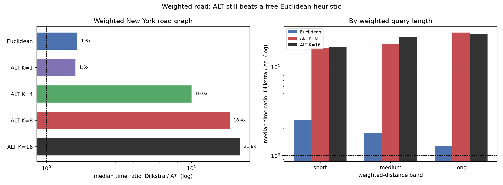

# Weighted road network: distance weights

This is a separate post-freeze data regime.  DIMACS `USA-road-d.NY` supplies the topology, integer distance edge weights, and coordinates (264,346 nodes, 730,100 undirected weighted arcs after symmetrisation).  The oracle and ALT landmark tables use weighted Dijkstra, and queries are selected in weighted-distance bands.  Dijkstra is the baseline; all treatments must return the same weighted shortest-path distance.

## Correctness

- 1,050 timed rows, all `status=ok` and `correct=1`.
- Every treatment returned the weighted Dijkstra optimum on all 30 queries; the maximum cost ratio is 1.000000.

## Overall

| variant | n | time ratio | time Q1 | time Q3 | exp ratio | exp Q1 | exp Q3 | cost max | optimal fraction |
|---|---|---|---|---|---|---|---|---|---|
| astar_alt1 | 30 | 1.589 | 1.286 | 2.568 | 2.254 | 1.607 | 3.160 | 1.000 | 1.000 |
| astar_alt16 | 30 | 21.620 | 15.752 | 44.232 | 31.095 | 21.276 | 62.011 | 1.000 | 1.000 |
| astar_alt4 | 30 | 10.016 | 4.708 | 22.158 | 14.575 | 7.221 | 27.723 | 1.000 | 1.000 |
| astar_alt8 | 30 | 18.367 | 6.976 | 26.631 | 25.762 | 13.063 | 41.147 | 1.000 | 1.000 |
| astar_alt8_node_id | 30 | 15.224 | 6.784 | 26.970 | 18.726 | 9.839 | 33.865 | 1.000 | 1.000 |
| astar_euclidean | 30 | 1.639 | 1.346 | 2.251 | 1.906 | 1.636 | 2.881 | 1.000 | 1.000 |

Time and expansion ratios are Dijkstra divided by the treatment; values above 1 mean A* wins.  ALT K=16 is the fastest treatment, and even the free Euclidean heuristic gives only a modest speedup because the road network is not geometrically straight.

## By weighted distance band

| variant | band | n | time ratio | exp ratio |
|---|---|---|---|---|
| astar_alt1 | short | 10 | 3.432 | 5.059 |
| astar_alt1 | medium | 10 | 1.639 | 2.254 |
| astar_alt1 | long | 10 | 1.213 | 1.469 |
| astar_alt16 | short | 10 | 16.717 | 28.880 |
| astar_alt16 | medium | 10 | 21.748 | 29.553 |
| astar_alt16 | long | 10 | 23.640 | 33.909 |
| astar_alt4 | short | 10 | 13.723 | 17.519 |
| astar_alt4 | medium | 10 | 5.768 | 7.932 |
| astar_alt4 | long | 10 | 13.556 | 15.489 |
| astar_alt8 | short | 10 | 16.389 | 23.253 |
| astar_alt8 | medium | 10 | 18.054 | 21.626 |
| astar_alt8 | long | 10 | 24.371 | 32.590 |
| astar_alt8_node_id | short | 10 | 17.135 | 23.108 |
| astar_alt8_node_id | medium | 10 | 16.422 | 20.702 |
| astar_alt8_node_id | long | 10 | 9.971 | 15.563 |
| astar_euclidean | short | 10 | 2.504 | 3.090 |
| astar_euclidean | medium | 10 | 1.794 | 2.108 |
| astar_euclidean | long | 10 | 1.290 | 1.491 |

ALT's advantage grows with the number of landmarks and is fairly flat across weighted bands at K=8-16.  K=1 is mainly a short-query heuristic (3.4x short versus 1.2x long).  Euclidean A* is strongest on short queries (2.5x) and nearly disappears on long queries (1.3x), where the straight-line bound is least informative.

## Tie-break under weighted edges

`astar_alt8_node_id` expands a median 1.08x as many vertices as `astar_alt8` and takes 1.08x the time.  Weighted edges reduce the number of equal-`f` choices compared with the unit-hop graph, but `larger_g` remains the safer rule.

## Reading

**ALT remains worth its preprocessing cost.**  ALT K=8 gives 18.4x median time and 25.8x fewer expansions; K=16 gives 21.6x and 31.1x.  Euclidean A* gives only 1.6x and 1.9x: it is cheap, but the straight-line bound is much weaker than landmark distances.

**Weights change the absolute numbers, not the ranking.**  The unweighted California graph and the weighted New York graph are different networks, so their speedups are not directly comparable.  Within the weighted graph, Dijkstra < Euclidean < ALT K=1 < ALT K=4 < ALT K=8 < ALT K=16 in median time.

**Tie-breaking is still visible.**  With distance weights the `node_id` rule is worse than `larger_g` on the ALT comparison, but the penalty is smaller than the 1.14x expansion penalty observed on the unit-hop California graph.  Fewer exact ties is exactly what the plateau mechanism predicts.

## Caveats

- This is the DIMACS New York network, not the frozen SNAP California network; do not compare absolute speedups across them.
- DIMACS distance weights are integer units proportional to road length; Euclidean coordinates are projected conservatively, so the Euclidean heuristic is admissible but not tight.
- The query set is new and selected in weighted bands; it is not the frozen 30-query set.
