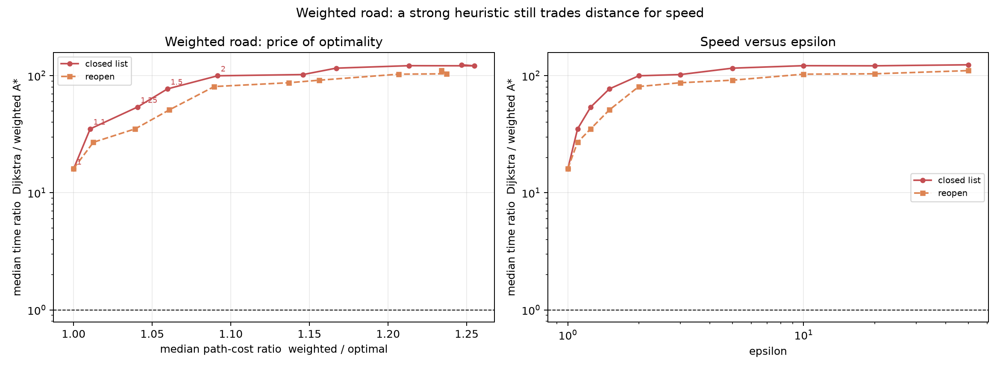

# Weighted road: weighted A* epsilon sweep

This is the weighted counterpart of the earlier weighted-A* study.  The graph is DIMACS `USA-road-d.NY` with distance weights and weighted ALT K=8.  Dijkstra supplies the optimal weighted distance; closed-list and reopening policies are both swept over `epsilon = 1, 1.1, 1.25, 1.5, 2, 3, 5, 10, 20, 50`.  Ratios are paired per query and are medians over five repeats.

## Correctness

- 3,150 timed rows, all `status=ok`.
- `epsilon=1` returned the weighted optimum under both policies; no weighted run returned a distance below the optimum.

## Full sweep

| policy | epsilon | n | time ratio | time Q1 | time Q3 | exp ratio | cost ratio | cost p95 | cost max | optimal fraction | within 1% | within 5% |
|---|---|---|---|---|---|---|---|---|---|---|---|---|
| closed | 1.000 | 30 | 15.995 | 7.826 | 25.834 | 25.762 | 1.000 | 1.000 | 1.000 | 1.000 | 1.000 | 1.000 |
| closed | 1.100 | 30 | 35.112 | 21.299 | 71.204 | 53.634 | 1.011 | 1.034 | 1.045 | 0.100 | 0.467 | 1.000 |
| closed | 1.250 | 30 | 53.919 | 33.118 | 104.084 | 71.550 | 1.041 | 1.075 | 1.102 | 0.100 | 0.267 | 0.700 |
| closed | 1.500 | 30 | 77.072 | 47.511 | 124.676 | 101.048 | 1.060 | 1.191 | 1.231 | 0.100 | 0.167 | 0.467 |
| closed | 2.000 | 30 | 99.782 | 54.055 | 143.729 | 136.863 | 1.092 | 1.264 | 1.389 | 0.033 | 0.067 | 0.367 |
| closed | 3.000 | 30 | 102.202 | 73.739 | 139.193 | 145.538 | 1.146 | 1.371 | 1.610 | 0.033 | 0.033 | 0.233 |
| closed | 5.000 | 30 | 115.945 | 75.234 | 154.775 | 154.197 | 1.167 | 1.497 | 1.610 | 0.033 | 0.033 | 0.167 |
| closed | 10.000 | 30 | 121.709 | 79.590 | 149.765 | 162.934 | 1.213 | 1.587 | 1.654 | 0.033 | 0.033 | 0.167 |
| closed | 20.000 | 30 | 121.407 | 71.706 | 161.714 | 165.010 | 1.255 | 1.592 | 1.644 | 0.033 | 0.033 | 0.167 |
| closed | 50.000 | 30 | 123.851 | 76.974 | 162.128 | 165.010 | 1.247 | 1.597 | 1.669 | 0.033 | 0.033 | 0.167 |
| reopen | 1.000 | 30 | 16.091 | 8.263 | 27.694 | 25.762 | 1.000 | 1.000 | 1.000 | 1.000 | 1.000 | 1.000 |
| reopen | 1.100 | 30 | 26.986 | 9.321 | 67.938 | 34.509 | 1.013 | 1.034 | 1.043 | 0.100 | 0.467 | 1.000 |
| reopen | 1.250 | 30 | 35.144 | 18.387 | 100.490 | 49.470 | 1.039 | 1.093 | 1.098 | 0.100 | 0.300 | 0.667 |
| reopen | 1.500 | 30 | 50.957 | 34.061 | 106.614 | 72.035 | 1.061 | 1.177 | 1.202 | 0.100 | 0.167 | 0.433 |
| reopen | 2.000 | 30 | 80.752 | 47.653 | 126.992 | 102.503 | 1.089 | 1.257 | 1.344 | 0.033 | 0.067 | 0.367 |
| reopen | 3.000 | 30 | 87.024 | 51.946 | 130.761 | 123.178 | 1.137 | 1.362 | 1.406 | 0.033 | 0.033 | 0.267 |
| reopen | 5.000 | 30 | 91.511 | 58.657 | 154.428 | 116.392 | 1.156 | 1.461 | 1.609 | 0.033 | 0.033 | 0.167 |
| reopen | 10.000 | 30 | 102.983 | 60.561 | 148.583 | 124.726 | 1.207 | 1.547 | 1.610 | 0.033 | 0.033 | 0.167 |
| reopen | 20.000 | 30 | 103.727 | 60.469 | 152.195 | 125.796 | 1.237 | 1.554 | 1.610 | 0.033 | 0.033 | 0.167 |
| reopen | 50.000 | 30 | 110.464 | 63.110 | 159.108 | 144.766 | 1.234 | 1.571 | 1.610 | 0.033 | 0.033 | 0.167 |

Cost ratio is returned weighted distance / optimal weighted distance.  Time ratio is Dijkstra / weighted A*.

## Best speed under a cost budget (closed list)

| cost budget | best epsilon | time ratio | median cost | cost p95 |
|---|---|---|---|---|
| 1.000 | 1.000 | 15.995 | 1.000 | 1.000 |
| 1.010 | 1.000 | 15.995 | 1.000 | 1.000 |
| 1.050 | 1.250 | 53.919 | 1.041 | 1.075 |
| 1.100 | 2.000 | 99.782 | 1.092 | 1.264 |
| 1.250 | 50.000 | 123.851 | 1.247 | 1.597 |

The budget is applied to the median query cost; p95 and max columns show the per-query tail.

## Reading

**The first percent is very cheap.**  Optimal ALT K=8 gives 16.0x in this sweep.  The closed-list `epsilon=1.1` variant reaches 35.1x for a median cost increase of 1.1%; `epsilon=1.25` reaches 53.9x for 4.1%.

**The closed list remains the better policy.**  At every `epsilon > 1` the closed list is faster than reopening for essentially the same path cost.  Reopening the weighted ALT search churns the heap without buying a meaningful distance improvement.

**The trade-off saturates.**  Above `epsilon=3` the time ratio changes little while the median cost continues to rise, so large epsilon is not attractive on this graph.  The practical knee is around `epsilon=1.1`-`1.25` if path quality matters.

## Caveats

- The weighted graph and query set are separate from the frozen California experiment; absolute ratios are not directly comparable.
- Cost is weighted distance, not travel time; the DIMACS weights are integer distance units.
- The budget is applied to the median; individual queries can exceed it, as the p95/max columns show.
